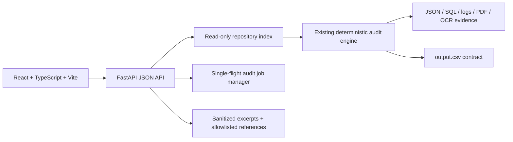

# GhostTrace — Privacy Deletion Audit & Evidence Explorer

GhostTrace is a full-stack portfolio application for auditing whether personal data was actually deleted. A React/Vite interface explores the results of a deterministic Python evidence engine, while a FastAPI backend exposes sanitized case, evidence, summary, and audit-job APIs.

> GhostTrace provides evidence-based audit assistance. It is not legal advice, a compliance certification, or proof that missing evidence means deletion occurred.

## Product tour

- **Dashboard:** live summary cards, status distribution, search, filtering, and pagination across audit cases.
- **Case Explorer:** identity history, audit cutoff, observed resources, evidence references, findings, remediation, and verification steps.
- **Evidence Explorer:** manifest search and sanitized excerpts with provenance and parser status.
- **Run Audit:** single-flight background execution with progress, cancellation, safe output replacement, and CSV download.
- **Methodology:** architecture, policy interpretation, privacy boundaries, and deployment limitations.

The app clearly labels synthetic demo mode. When the participant-facing dataset is present locally, the backend reads it through the existing engine; it never duplicates deletion logic in TypeScript.

## Architecture



Backend responsibilities remain in `code/` and `backend/`. Frontend responsibilities remain in `frontend/`. Detailed decisions are documented in [`docs/architecture.md`](docs/architecture.md), API behavior in [`docs/api.md`](docs/api.md), and deployment preparation in [`docs/deployment.md`](docs/deployment.md).

## Stack

**Backend:** Python 3.11+, FastAPI, Uvicorn, Pydantic, SQLite-compatible parsing, pypdf, Pillow, pytesseract, pytest.

**Frontend:** React, TypeScript, Vite, Tailwind CSS, Recharts, Lucide icons, typed fetch client.

No external AI provider or paid API is required.

## Run locally on Windows

From the repository root:

```powershell
py -3 -m venv .venv
.\.venv\Scripts\Activate.ps1
python -m pip install --upgrade pip
python -m pip install -r requirements.txt
```

For complete screenshot evidence extraction, install Tesseract OCR and ensure `tesseract.exe` is on `PATH`. The backend records OCR failures and continues when it is unavailable.

Start the API:

```powershell
python -m uvicorn backend.main:app --reload --port 8000
```

In a second terminal:

```powershell
Set-Location frontend
npm install
npm run dev
```

Open `http://localhost:5173`. The frontend defaults to `http://localhost:8000`; override it with `frontend/.env.local`:

```text
VITE_API_BASE_URL=http://localhost:8000
```

If the dataset is absent, the API starts in synthetic demo mode. Demo fixtures are labeled and must not be presented as evaluation results.

## Engine and validation commands

```powershell
# Generate the required CSV
python code/main.py

# Validate schema, JSON, evidence references, cutoffs, and ordering
python code/output_validator.py

# Run backend and engine regression tests
python -m pytest -q

# Run public-sample evaluation when sample files are available
python code/evaluation/main.py
```

The existing engine’s reproducible full run produces 518 rows when the supplied dataset is present. Its measured public-sample results and limitations are recorded in [`code/evaluation/evaluation_report.md`](code/evaluation/evaluation_report.md). The web layer does not change the meanings of `COMPLETE`, `INCOMPLETE`, or `NOT_APPLICABLE`.

## Frontend build and deployment

```powershell
Set-Location frontend
npm run typecheck
npm run build
npm run preview -- --host 127.0.0.1 --port 4173
```

The intended beginner-friendly deployment is Vercel/Netlify for `frontend/` and Render for the FastAPI service. See [`docs/deployment.md`](docs/deployment.md) for exact commands, environment variables, CORS, health checks, and the current ephemeral-storage limitation. No live deployment has been performed from this repository, so no hosted URL is claimed.

## Security and privacy

- The frontend receives masked identifiers and sanitized excerpts rather than raw evidence by default.
- Evidence IDs are resolved only through the manifest or known system-activity references.
- The API does not expose directory listings, arbitrary file paths, uploaded executable content, or SQL execution endpoints.
- CORS origins are explicit and request body/rate limits are applied at the API boundary.
- The current audit job manager is in-memory and local-output based; persistent storage and a durable queue are required for a multi-instance production deployment.
- Use synthetic data for public screenshots and demos. Do not deploy the challenge dataset without permission.

## Screenshots

Screenshots are intentionally not fabricated. Capture sanitized screenshots after starting the local app and add them here:

```text
docs/screenshots/dashboard.png
docs/screenshots/case-explorer.png
docs/screenshots/evidence-explorer.png
```

## Portfolio materials

See [`docs/resume_project.md`](docs/resume_project.md) for the concise description, technically accurate resume bullets, verified capabilities, and interview-ready architecture explanation.
